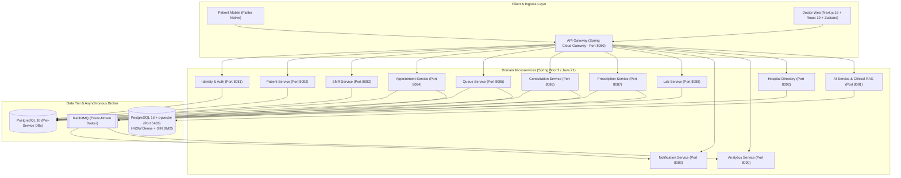

# CareFlow — Outpatient Clinical Healthcare Platform (Microservices & Clinical RAG)

**Repository Link:** [https://github.com/ntkhai268/careflow](https://github.com/ntkhai268/careflow)  
**Role:** Backend & AI Architect (University Capstone Project — Team C35)  
**Timeframe:** 2026  

---

## 🚀 Executive Architecture Overview

**CareFlow** is an enterprise-scale outpatient clinical healthcare platform engineered to modernize outpatient care in public hospitals. The platform streamlines high-volume clinical workflows, connecting native patient mobile applications with a specialized web-based doctor consultation workspace, backed by a resilient distributed microservices ecosystem and an evidence-grounded Clinical Retrieval-Augmented Generation (RAG) assistant.

---

## 🛠️ Technology Stack

| Layer | Technologies & Frameworks | Strategic Purpose |
| :--- | :--- | :--- |
| **Backend Core** | Java 21, Spring Boot 3, Spring Cloud Gateway, Eureka Server | High-throughput domain microservices, resilient API gateway routing, and service discovery. |
| **Vector DB & Caching** | PostgreSQL 16, `pgvector` (0.8.7), Docker | Dual HNSW cosine distance index & GIN BM25 full-text index for sub-100ms clinical retrieval. |
| **Relational DB** | PostgreSQL 16 (Database-per-Service pattern) | ACID transactions, strict schema isolation across 12 domain databases. |
| **Messaging & Events** | RabbitMQ, Outbox Pattern | Asynchronous cross-service domain event streaming and event-carried state updates. |
| **AI & LLM Services** | Gemini 2.5 Flash, DeepSeek API fallback, Python RAG worker | Dense text embeddings (768d), clinical decision synthesis, and drug interaction guardrails. |
| **Frontend Doctor Web** | Next.js 15 (App Router), React 19, TypeScript, Tailwind CSS, Zustand | High-performance medical workstation conforming to SJD Barcelona Hospital UI standards. |
| **State & Audio Dictation** | Zustand (`useVoiceStore`), Web Audio / MediaRecorder API | Atomic state store isolating audio streams, providing 0% form re-render lag and 1-click JSON auto-fill. |
| **Code Intelligence** | GitNexus (23,803 symbols, 52,888 relationships, 850 flows) | Graph-based blast-radius impact analysis preventing breaking changes across microservices. |

---

## 🧠 Core Engineering Achievements

### 1. Clinical RAG Engine with Hybrid Search & Reciprocal Rank Fusion (RRF)
- **Problem**: Standard LLM prompting generates unacceptable medical hallucinations. Pure dense vector search fails on precise drug names and chemical codes, while pure keyword matching misses semantic synonyms in patient symptoms.
- **Solution**: Built a two-stage Hybrid Search engine in Spring Boot 3 using `pgvector`:
  - **Dense Stage**: Cosine distance search using HNSW indexing (`<=>`).
  - **Sparse Stage**: BM25 full-text ranking using PostgreSQL GIN index (`tsv_content`).
  - **Fusion Algorithm**: Reciprocal Rank Fusion (RRF, $k=60$) merging candidate sets to extract Top 5 clinical chunks.
- **Indexed Clinical Knowledge**:
  - **15,844 ICD-10** disease classification codes standardized in Vietnamese.
  - **701 Contraindicated Drug-Drug Interaction (DDI) Pairs** based on Decision 5948/QĐ-BYT.
  - **1,095 Semantic Chunks** of official Ministry of Health practice guidelines (Diabetes Type 2 - QĐ 5481, Hypertension - QĐ 3192, Community-Acquired Pneumonia - QĐ 4815) structured with hierarchical breadcrumbs and 768-dimensional embeddings.

### 2. Dual Voice-to-Text Architecture & Atomic Zustand Store
- **Consultation Clinical Voice STT**: Allows physicians to dictate symptoms, medical history, and examination findings hands-free. Audio processing is decoupled into a dedicated Zustand store (`useVoiceStore`), completely isolating audio chunks, timer intervals, and transcripts from the React render tree.
- **Voice Prescription Drafting**: Integrates speech recognition with automatic clinical entity extraction (`PrescriptionAiDraftService`), parsing drug names, dosage amounts, and administration routes directly into draft prescription items.
- **Performance Impact**: Completely eliminated input latency and layout freezing on complex clinical forms (>2,600 LOC), providing instant cancel/retry controls and one-click JSON form auto-fill.

### 3. Microservices Harmonization & GitNexus Graph Intelligence
- Used GitNexus graph analysis across the repository's 23,803 symbols and 850 execution flows to conduct upstream and downstream blast-radius verification before modifying shared contracts.
- Successfully merged and resolved 7 major cross-service conflicts between the AI service branch and develop baseline releases (R0–R7), achieving 100% test pass rate (13/13 unit and integration tests in `careflow-ai-service`).

---

## 💼 Resume & CV Highlights (Ready to Copy)

- **Backend & AI Architecture**:
  > *"Architected and deployed a distributed hospital outpatient healthcare system comprising 12+ Spring Boot 3 microservices with independent PostgreSQL databases, Spring Cloud Gateway, and RabbitMQ event streaming."*

- **Clinical RAG & Vector Search**:
  > *"Engineered an evidence-based Clinical RAG service in Java 21 and PostgreSQL pgvector (0.8.7), combining HNSW dense cosine search with GIN BM25 full-text queries via Reciprocal Rank Fusion (RRF, k=60) across 1,095 Ministry of Health guideline chunks and 701 contraindicated DDI pairs."*

- **Frontend Performance & Dual Voice Dictation**:
  > *"Built a Next.js 15 and React 19 Doctor Web workspace following SJD Barcelona hospital design standards; eliminated form re-render freezes (0% lag) using an atomic Zustand audio store with hands-free speech-to-text dictation and 1-click clinical form auto-fill."*
