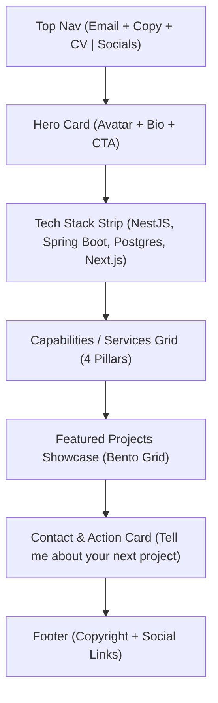

# Hệ Thống Thiết Kế & Giao Diện Portfolio (Design System)

> **Cảm hứng thiết kế:** Dựa trên phong cách Soft Bento / Clean Neomorphism Minimalism từ bộ ảnh mẫu.  
> **Mục tiêu:** Tạo nên một website Portfolio cá nhân hiện đại, tinh giản, cao cấp, làm nổi bật năng lực kỹ thuật của **Nguyễn Đức Vĩ** (Backend / Full-Stack Engineer).

---

## 1. Triết Lý & Ngôn Ngữ Thiết Kế (Design Philosophy)

* **Soft Bento-Box Aesthetic:** Bố cục sử dụng các khối thẻ bo góc lớn (`rounded-3xl` đến `rounded-[40px]`), xếp tầng mềm mại tạo cảm giác như một mặt phẳng cao cấp được hoàn thiện tỉ mỉ.
* **Warm Neutral & Texture:** Nền xám ấm nhạt phối hợp bề mặt trắng sứ, có thể phủ nhẹ một lớp noise texture (2-3% opacity) mang lại cảm giác analog sang trọng, không bị chói mắt.
* **Pill-shaped Elements (Viên thuốc):** Tất cả các nút bấm CTA, badge phân loại (Tags), nút chuyển hướng đều sử dụng dạng viên thuốc bo tròn tuyệt đối (`rounded-full`).
* **Micro-interactions:** Hiệu ứng hover mềm, nút copy email 1-click phản hồi tức thì, tooltip tương tác mượt mà.

---

## 2. Bảng Mã Màu & Thuộc Tính Thiết Kế (Design Tokens)

### 🎨 Bảng màu (Color Palette)
| Tên Token | Mã Hex / HSL | Ứng Dụng |
| :--- | :--- | :--- |
| **Canvas Background** | `#EFEFED` / `#F4F4F2` | Nền tổng thể toàn trang (Warm light gray) |
| **Card Surface** | `#FFFFFF` | Nền các khối thẻ chính (Hero container, Contact card) |
| **Card Secondary** | `#F8F8F7` | Nền phụ của các box chức năng |
| **Text Primary** | `#121214` | Tiêu đề H1, H2, chữ nổi bật (Deep Charcoal) |
| **Text Secondary** | `#6B6D74` | Nội dung mô tả, phụ đề, nhãn liên hệ |
| **Text Muted** | `#9C9EA6` | Bản quyền, icon phụ trợ |
| **Border Soft** | `rgba(0, 0, 0, 0.06)` | Viền mảnh định hình các khối |
| **Primary Button** | `#121214` (Chữ `#FFFFFF`) | Nút CTA chính (Explore Projects, Email Me) |
| **Secondary Button** | `#FFFFFF` (Viền xám mảnh) | Nút phụ (Copy, CV, LinkedIn) |

### 🔤 Kiểu Chữ (Typography)
* **Font gia đình khuyến nghị:** `Plus Jakarta Sans` hoặc `Geist Sans` / `Inter`.
* **H1 (Hero Heading):** `font-bold`, cỡ `text-4xl md:text-6xl`, `tracking-tight`, `leading-[1.15]`.
* **H2 (Section Heading):** `font-semibold`, cỡ `text-2xl md:text-4xl`, canh giữa (`text-center`).
* **Body / Description:** `font-normal`, cỡ `text-sm md:text-base`, `leading-relaxed`.
* **Badge / Tag:** `font-medium`, cỡ `text-xs md:text-sm`, viết hoa chữ cái đầu.

### 📐 Bo Góc & Đổ Bóng (Radii & Shadows)
* **Outer Container / Hero Frame:** `rounded-[32px] md:rounded-[48px]`
* **Inner Cards:** `rounded-2xl md:rounded-3xl`
* **Buttons & Badges:** `rounded-full`
* **Shadow:** Đổ bóng cực mềm: `box-shadow: 0 10px 30px -10px rgba(0, 0, 0, 0.05);`

---

## 3. Kiến Trúc Bố Cục Từng Khối (Component Architecture)



### Khối 1: Khung Hero & Header tích hợp (Hero Container)
* **Thanh Header tích hợp:**
  * **Bên trái:** 
    * Địa chỉ email: `contact@vinguyen.id.vn`
    * Nút `Copy` (Click để sao chép clipboard + Toast thông báo).
    * Nút `CV` (Tải/Xem bản PDF cập nhật).
  * **Bên phải:** Social links dạng text tối giản: `GitHub` / `LinkedIn` / `Email`.
* **Nội dung Hero chính:**
  * **Avatar tròn:** Có sticker badge nổi bên cạnh: `Vi Nguyen 👋` hoặc `Available for work 🟢`.
  * **Khẩu hiệu chính (Heading):** 
    > *"Architecting robust backend systems, high-performance APIs, and modern digital experiences."*
  * **CTA Button:** Nút viên thuốc màu đen `Explore Projects ↗` hoặc `View Case Studies ↗`.

---

### Khối 2: Dải Nhận Diện Công Nghệ (Tech Stack / Tooling Strip)
* Thay vì logo đối tác client như bản mẫu thiết kế đồ họa, website của Vĩ sẽ là dải monochrome logo các công nghệ cốt lõi:
  * **Backend & DB:** `NestJS`, `Spring Boot`, `PostgreSQL`, `Redis`
  * **Full-stack & DevOps:** `Next.js`, `TypeScript`, `Docker`, `Clerk`

---

### Khối 3: Năng Lực Cốt Lõi (Core Capabilities / Services)
* **Huy hiệu phần:** Huy hiệu nổi dạng pill: `Capabilities` / `Specialties`.
* **Tiêu đề khối:**
  > *"Focused on clean architecture, scalable databases, and end-to-end reliability."*
* **Lưới 4 cột (Grid 4 items):**
  1. **Backend & Microservices:** Thiết kế RESTful API, Layered Architecture, Guards/Interceptors (NestJS, Spring Boot).
  2. **Database & Optimization:** Chuẩn hóa quan hệ dữ liệu, caching Redis, tối ưu query (PostgreSQL, TypeORM).
  3. **Full-Stack & Next.js:** Xây dựng giao diện ứng dụng tốc độ cao với Next.js 15 App Router, React 19, Tailwind CSS.
  4. **Security & Integrations:** Xác thực RBAC (Clerk/OAuth2), webhook bảo mật (Svix), cổng thanh toán (PayOS), Cloudinary.

---

### Khối 4: Dự Án Tiêu Biểu (Featured Case Studies - Bento Style)
Trưng bày 4 dự án lớn từ CV dưới dạng thẻ ảnh + thông số công nghệ:
1. **StudyMate:** E-Learning Management System (NestJS, Next.js 15, PostgreSQL, Redis, Clerk).
2. **VietSneaker:** Nền tảng TMĐT & Recommender AI (Spring Boot, Next.js, Redis, DeepSeek AI).
3. **HCMC Metro Smart System:** Hệ thống quản lý tàu đô thị & AI Face Recognition (React 19, Node.js, TensorFlow.js).
4. **Slack / Messaging Realtime Project:** Ứng dụng chat realtime.

---

### Khối 5: Kêu Gọi Hành Động (Contact / CTA Card)
* Khung card bo cong mềm mại riêng biệt ở chân trang:
  * Icon biểu tượng bàn tay kết nối / bắt tay (`🤝`).
  * **Tiêu đề lớn:** *"Tell me about your next project or role"*
  * **Mô tả ngắn:** Đang mở cơ hội cho vị trí Backend / Full-stack Developer (Internship/Fresher).
  * **Hai nút hành động:**
    * `Email Me` (Nút đen nổi bật trỏ `mailto:contact@vinguyen.id.vn`)
    * `LinkedIn` / `WhatsApp` (Nút trắng viền mảnh)

---

### Khối 6: Chân Trang (Footer)
* Bố cục 1 hàng tinh giản:
  * Trái: `© 2026 Vi Nguyen. All rights reserved.`
  * Phải: Các liên kết mạng xã hội `GitHub / LinkedIn / Portfolio`.

---

## 4. Hướng Dẫn Kỹ Thuật Khi Lắp Ráp Code (Next.js & Tailwind CSS)

```tsx
// Cấu trúc mẫu cho Container Card viền mềm kiểu Bento
<div className="mx-auto max-w-6xl px-4 py-8">
  <div className="bg-[#FFFFFF] border border-black/[0.06] rounded-[36px] md:rounded-[48px] p-8 md:p-14 shadow-sm">
    {/* Header & Hero Content */}
  </div>
</div>
```

* **Tailwind classes chủ đạo:**
  * Khung viền lớn: `rounded-[40px] border border-zinc-200/60 bg-white`
  * Nút pill đen: `rounded-full bg-zinc-950 px-6 py-3 text-sm font-medium text-white hover:bg-zinc-800 transition-all`
  * Nút pill trắng: `rounded-full bg-white border border-zinc-200 px-5 py-2.5 text-sm font-medium text-zinc-900 hover:bg-zinc-50 transition-all`
  * Tag danh mục: `inline-flex items-center gap-1.5 rounded-full border border-zinc-200/80 bg-white/80 px-3 py-1 text-xs font-medium text-zinc-600`
